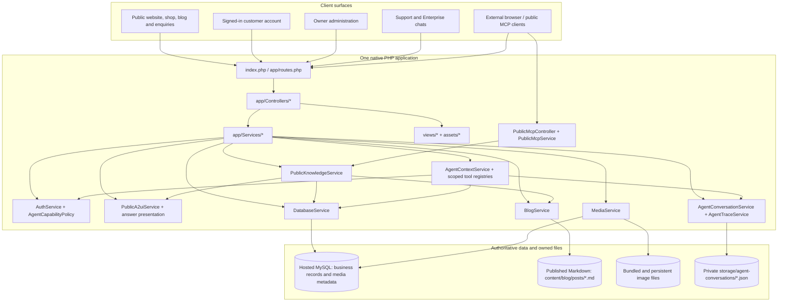
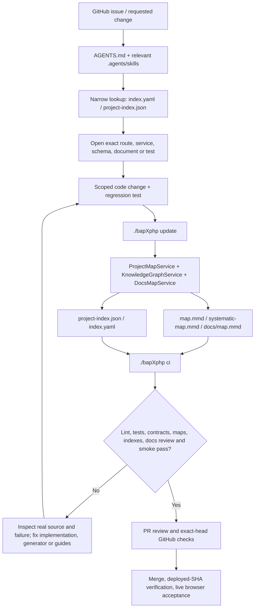

# Sri Panchami Spiritual

Native PHP application for small PHP hosting (including single-site shared hosting) with a `public_html` deployment; target PHP 8.3+ and MySQL 8.4+ (verify the deployed environment). It uses
server-rendered PHP templates, hosted MySQL as the primary runtime store, Markdown
blog posts, and file-based images. There is no SPA or frontend build step.

## Start here

| Question | First source | Then verify |
|---|---|---|
| What are the agent rules? | `AGENTS.md` | matching `.agents/skills/*/SKILL.md` |
| Does a route/service/view/collection exist? | `docs/project-index.json` | original PHP/schema file |
| How is a request wired? | `map.mmd` | `app/routes.php` → controller → service → view |
| Where is a blog or image? | `index.yaml` narrow concept/filename search | returned Markdown/image path |
| What is the database shape? | `storage/schema/collections.php` | owning service/admin form |
| What is a live editable value? | hosted MySQL through `DatabaseService` | lowercase `/remotedb` fallback |
| What controls UI? | `Design.md` | `assets/css/band.css` and PHP view |

Read the `index.yaml` header, run the relevant narrow query, then open the original
source. Match routes by HTTP method and exact pattern. The route ID search uses `rg`
when `jq` is unavailable.

```bash
sed -n '1,/^concepts:/p' index.yaml
jq --arg method POST --arg path /contact '.routes[] | select(.method == $method and .path == $path)' docs/project-index.json
rg -n -A14 '^  - id: "route:post__contact"$' index.yaml
rg -n -B4 -A14 'id: "schema:products"' index.yaml
rg -n -B4 -A12 'filename: "<image-name>"' index.yaml
```

## Source-of-truth boundaries

- Admin-editable products, categories, consultants, temples, orders, users, settings,
  secrets, and related records live only in hosted MySQL.
- Local development uses direct hosted MySQL or configured `<APP_URL>/remotedb`; it
  must not create a local product/catalogue copy.
- Blog bodies live in `content/blog/posts/*.md` with YAML frontmatter.
- Image binaries live under `assets/images/` or the writable upload location.
- `storage/schema/collections.php` is the canonical database schema.
- `MediaService` stores uploaded image metadata in MySQL `media_files` and reads legacy metadata in `storage/media/*.yaml` for compatibility.
- Generated maps and indexes point to originals; they are navigation artifacts, not
  alternate sources of truth.

## Repository layout

```text
app/routes.php                  HTTP route registry
app/Controllers/               request/auth/response handling
app/Services/                  domain and persistence boundaries
views/                         server-rendered PHP templates
assets/                        CSS, JavaScript, and image binaries
content/blog/posts/            Markdown blog/help articles
storage/schema/collections.php canonical MySQL schema
docs/project-index.json        generated existence inventory
map.mmd                        generated dependency graph
index.yaml                     generated concept/relationship router
tests/run.php                  application regression suite
```

## Local setup

Copy safe connection placeholders from `.env.example` into an ignored `.env`.
Required configuration is the application URL plus hosted-MySQL/direct-remote access.
Application credentials are managed through Admin → Integrations and stored in the
MySQL `secrets` collection; never put real values in tracked files.
Use `APP_NAME` and `APP_URL` for installation identity and Admin → Settings for site
and store behaviour.

```bash
./bapXphp help
./bapXphp map
./bapXphp schema list
./bapXphp serve
```

The development server runs at `http://127.0.0.1:6020`. Browser-test credentials and
the fixed customer test ID are in ignored `.env.test-user`; never print or commit them.

## Verified project commands

```bash
./bapXphp route:list             # registered routes and owners
./bapXphp skills                 # tool-compatible project skills
./bapXphp db status              # direct/remote database readiness
./bapXphp db query products --limit 5
./bapXphp read blog [slug]
./bapXphp write blog [slug]
./bapXphp blog:image <slug> <image> [options]
./bapXphp dev:user --dry-run
./bapXphp logs --limit 20
./bapXphp update                 # regenerate maps and indexes
./bapXphp ci                     # lint, tests, drift validation, smoke
```

There is no `bapXphp tui` or agent-orchestration CLI. Web QA uses the active coding
client's browser capability and is not part of the application runtime.

## Architecture: the application and its source-grounded development system

This is a **working PHP customer application**, not a graph search service. The diagram below is a compact, source-reviewed view of the actual [route registry](app/routes.php), [controllers](app/Controllers), [services](app/Services), [storage schema](storage/schema/collections.php), and public/agent interfaces. It is not a second route registry or a complete call graph. For **every registered route, service, view, schema collection, tool, and detected mapping gap**, use the committed, CI-checked [code dependency graph](map.mmd) and [systematic map](docs/systematic-map.mmd).



**Authority and isolation:** Application code and [canonical schema](storage/schema/collections.php) define implementation behaviour; the actual hosted MySQL records define live business facts. The [published article source](content/blog/posts) and owned media files remain their own authoritative content. Support, Enterprise and public MCP capabilities do **not** share unrestricted permissions: [agent capability policy](app/Services/AgentCapabilityPolicy.php), [runtime instruction allowlists](app/Services/AgentInstructionService.php), and public-only [MCP](app/Services/PublicMcpService.php) enforce separate boundaries. Coding-agent [AGENTS.md](AGENTS.md) and [skills](.agents/skills) are developer instructions, **never** runtime customer-agent prompts.

### How source-derived project knowledge constrains an agent change

The project does not ask the model to reconstruct its architecture from chat history or approximate vector matches. Generated artifacts point to **original source** and are checked against it; a graph is useful here because it forms part of the acceptance contract, not merely because it makes search convenient.



The specific enforced checks are in [cli/bapXphp](cli/bapXphp), [ProjectMapService](app/Services/ProjectMapService.php), [KnowledgeGraphService](app/Services/KnowledgeGraphService.php), and [the documentation-review gate](cli/docs-check.php). `./bapXphp update` **regenerates** machine-derived artifacts; `./bapXphp ci` detects stale generated outputs and failing tests. Documentation review requires an explicit source-versus-guide rationale; regenerating a map does not approve incorrect prose. Failed checks must be corrected and rerun **before claiming completion**. CI success still does not substitute for human review, authorization testing, real business-data verification or live browser acceptance.

**Graph coverage is bounded.** The generator inventories registered routes, discovered code/schema resources, static service→collection references and declared relationships, and reports known gaps. That helps reveal missing wiring, drift, stale assumptions and affected code. It is **not** a proof that all security vulnerabilities, dynamic call paths, business-logic faults or runtime failures have been detected; those require dedicated tests and evidence. An index entry shows that a resource exists, not that its feature works.

### Capability comparison — integrated application versus isolated tools

This is a **scope comparison**, not a benchmark or claim of universal superiority. The same feature name in two products does not imply identical implementation, deployment cost or test coverage.

| Capability | Code search / graph utilities (e.g. GitNexus, Aider, Serena) | Business suites (e.g. Odoo, ERPNext, Dolibarr) | This repository |
|---|---|---|---|
| Real public website, admin, commerce and customer workflows | Outside their core purpose | Commonly provided, depending on edition/modules | Existing PHP routes, controllers, services and views |
| Answer from actual business database and published documents | Requires application-specific integration | Through each suite's own business modules | `DatabaseService`, `BlogService`, `PublicKnowledgeService`, scoped agent tools |
| Exact source-linked architecture inventory | Code/symbol mapping is a principal capability | Depends on the suite and development tooling | `ProjectMapService`, generated `map.mmd` and `project-index.json` |
| Agent development guidance with source-based verification | Tool-dependent | Tool-dependent | `AGENTS.md`, skills, `./bapXphp update`, `./bapXphp ci`, review receipts |
| Detect and reject stale generated project knowledge | Tool-dependent | Tool-dependent | CI compares freshly generated maps and indexes; source/doc review requires an explicit rationale |
| Production server requirements | These developer tools may need separate local/server runtimes | Each suite has its own requirements | Native PHP + supported hosted MySQL; no always-running Python/Node/embedding/graph service required on customer hosting |

**The integration is the point:** a developer tool may help locate code and an ERP may provide business modules, but neither category alone establishes this project's specific **source → map/index → agent constraints → implementation → failing/passing CI → review → deployed-verification** contract. The published [development workflow](docs/development-workflow.md) defines the real handoff and release process. This table is not a substitute for benchmarked task outcomes or security acceptance.

## Validation

Run the smallest relevant check while working, then the full suite before publishing:

```bash
php -l path/to/changed.php
./bapXphp update
./bapXphp ci
```

For UI changes, use the built-in Browser to test the actual route at desktop and
375 px. See the [release workflow](docs/deployment-hostinger.md#release-workflow)
for the review, merge, and production checks.

## Deployment

`bapxmediahub/bapXphpAiBackend` is the deployment repository. The one-time Hostinger
Git integration tracks `main`; changes merged to `main` are pulled to the live site.
After merge, verify the deployed revision and live route health—merge status alone is
not deployment proof. See `docs/README.md`, `docs/deployment-hostinger.md`, `AGENTS.md`,
and `docs/systematic-map.mmd` for the verified navigation and operating contracts.

Use plain Git locally. Pushing `codex/**`, `fix/**`, or `feat/**` can create a PR via
`.github/workflows/branch-pr.yml`; `.github/workflows/ci.yml` validates PRs and pushes
to `main`.

## Native runtime baseline

Target stable PHP **8.3+** and MySQL **8.4+** with cURL, JSON, mbstring,
PDO MySQL and OpenSSL. `./bapXphp runtime:check --json --strict` checks the
current CLI environment; the authenticated **System Health** page checks web
PHP. MariaDB is a different engine, not a passing MySQL8.4 version. The checker
is read-only and does not migrate existing customer deployments. See
`docs/runtime-requirements.md`.
