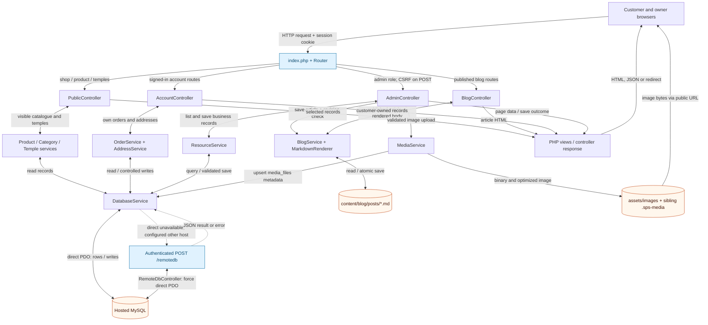
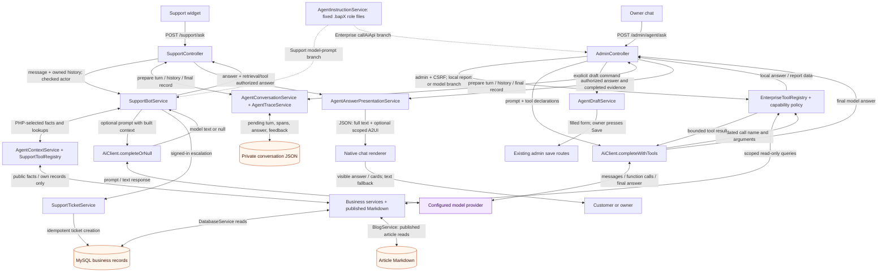
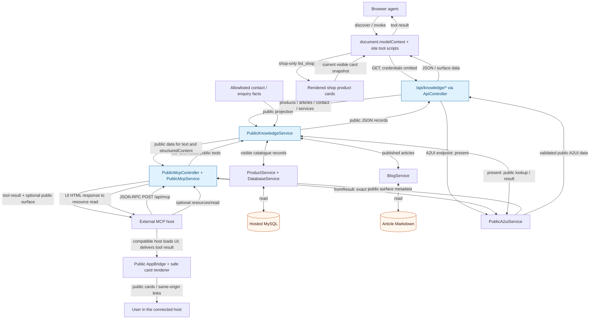
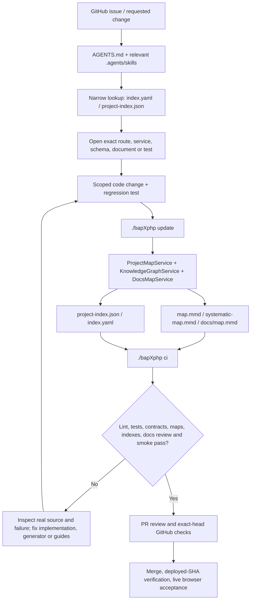

# Sri Panchami Spiritual

Native PHP application for small PHP hosting (including single-site shared hosting) with a `public_html` deployment; target PHP 8.3+ and MySQL 8.4+ (verify the deployed environment). It uses
server-rendered PHP templates, hosted MySQL as the primary runtime store, Markdown
blog posts, and file-based images. There is no SPA or frontend build step.

## Start here

| Question | First source | Then verify |
|---|---|---|
| What are the agent rules? | `AGENTS.md` | matching `.agents/skills/*/SKILL.md` |
| Does a route/service/view/collection exist? | `docs/project-index.json` | original PHP/schema file |
| How is a request wired? | `map.mmd` | `app/routes.php` → controller → service → view |
| Where is a blog or image? | `index.yaml` narrow concept/filename search | returned Markdown/image path |
| What is the database shape? | `storage/schema/collections.php` | owning service/admin form |
| What is a live editable value? | hosted MySQL through `DatabaseService` | lowercase `/remotedb` fallback |
| What controls UI? | `Design.md` | `assets/css/band.css` and PHP view |

Read the `index.yaml` header, run the relevant narrow query, then open the original
source. Match routes by HTTP method and exact pattern. The route ID search uses `rg`
when `jq` is unavailable.

```bash
sed -n '1,/^concepts:/p' index.yaml
jq --arg method POST --arg path /contact '.routes[] | select(.method == $method and .path == $path)' docs/project-index.json
rg -n -A14 '^  - id: "route:post__contact"$' index.yaml
rg -n -B4 -A14 'id: "schema:products"' index.yaml
rg -n -B4 -A12 'filename: "<image-name>"' index.yaml
```

## Source-of-truth boundaries

- Admin-editable products, categories, consultants, temples, orders, users, settings,
  secrets, and related records live only in hosted MySQL.
- Local development uses direct hosted MySQL or configured `<APP_URL>/remotedb`; it
  must not create a local product/catalogue copy.
- Blog bodies live in `content/blog/posts/*.md` with YAML frontmatter.
- Image binaries live under `assets/images/` or the writable upload location.
- `storage/schema/collections.php` is the canonical database schema.
- `MediaService` stores uploaded image metadata in MySQL `media_files` and reads legacy metadata in `storage/media/*.yaml` for compatibility.
- Generated maps and indexes point to originals; they are navigation artifacts, not
  alternate sources of truth.

## Repository layout

```text
app/routes.php                  HTTP route registry
app/Controllers/               request/auth/response handling
app/Services/                  domain and persistence boundaries
views/                         server-rendered PHP templates
assets/                        CSS, JavaScript, and image binaries
content/blog/posts/            Markdown blog/help articles
storage/schema/collections.php canonical MySQL schema
docs/project-index.json        generated existence inventory
map.mmd                        generated dependency graph
index.yaml                     generated concept/relationship router
tests/run.php                  application regression suite
```

## Local setup

Copy safe connection placeholders from `.env.example` into an ignored `.env`.
Required configuration is the application URL plus hosted-MySQL/direct-remote access.
Application credentials are managed through Admin → Integrations and stored in the
MySQL `secrets` collection; never put real values in tracked files.
Use `APP_NAME` and `APP_URL` for installation identity and Admin → Settings for site
and store behaviour.

```bash
./bapXphp help
./bapXphp map
./bapXphp schema list
./bapXphp serve
```

The development server runs at `http://127.0.0.1:6020`. Browser-test credentials and
the fixed customer test ID are in ignored `.env.test-user`; never print or commit them.

## Verified project commands

```bash
./bapXphp route:list             # registered routes and owners
./bapXphp skills                 # tool-compatible project skills
./bapXphp db status              # direct/remote database readiness
./bapXphp db query products --limit 5
./bapXphp read blog [slug]
./bapXphp write blog [slug]
./bapXphp blog:image <slug> <image> [options]
./bapXphp dev:user --dry-run
./bapXphp logs --limit 20
./bapXphp update                 # regenerate maps and indexes
./bapXphp ci                     # lint, tests, drift validation, smoke
```

There is no `bapXphp tui` or agent-orchestration CLI. Web QA uses the active coding
client's browser capability and is not part of the application runtime.

## Application architecture and data flows

The views below follow the request handlers and persistence code behind the [generated dependency map](map.mmd). They show **who calls whom, what is read or written, and what returns to the caller**. The [systematic map](docs/systematic-map.mmd) and [project index](docs/project-index.json) provide the longer route/class inventory. Their declared and statically inferred edges are discovery aids; the linked implementations determine execution order, permissions and data direction.

### 1. Website, owner edits and authoritative storage

An owner edit and a customer read converge on the same business records. Blog bodies and image binaries take different paths. In this view, arrows name operations; two-way arrows include the returned records/content.



`app/routes.php` obtains its executable route list from `ProjectMapService::registry()`; `Router::dispatch()` invokes the declared controller action. Account/admin checks run in their controllers, while public browsing remains public. `/api/...` uses `api/index.php` and JSON responses; the public tool adapters are detailed in view 4.

**Source trail:** [entry and image serving](index.php), [route dispatch](app/Router.php), [page reads](app/Controllers/PublicController.php), [account ownership](app/Controllers/AccountController.php), [owner saves](app/Controllers/AdminController.php), [resource persistence](app/Services/ResourceService.php), [database transport](app/Services/DatabaseService.php), [remote bridge](app/Controllers/RemoteDbController.php), [blog persistence](app/Services/BlogService.php), [media persistence](app/Services/MediaService.php), [response rendering](app/Controllers/BaseController.php).

| Data | Authority and writer | How it reaches a reader |
|---|---|---|
| Products, categories, users, addresses, orders, settings and secrets | Hosted MySQL through `DatabaseService`; canonical fields in [collections.php](storage/schema/collections.php) | Services return selected records to controllers or scoped tools. Public responses do not expose entire settings/secret records. |
| Cart, login identity and pending checkout | Server-side PHP session; browser holds its session cookie | Cart stores slugs/quantities. Current prices and visibility are resolved from `ProductService` before checkout. |
| Article body and frontmatter | `BlogService` reads/writes `content/blog/posts/*.md` | Publication checks and `MarkdownRenderer` produce the public blog body. |
| Image bytes and metadata | `MediaService` writes uploads outside the checkout in sibling `.sps-media`; new metadata goes to MySQL `media_files` | Product/article records carry image URLs. The browser fetches bytes separately. Bundled images and read-only legacy YAML remain compatibility inputs. |
| Chat turns, feedback and execution traces | `AgentConversationService` owns one private JSON per conversation | Actor/surface checks gate history and context. Traces are checkpointed into the same file; view 3 shows this path. |
| Mail and operational audit | MySQL `mail_queue`, `mail_outbox`, `audit_events` | Delivery attempts update queue/outbox state; audit metadata is separate from private chat transcripts. |

### 2. Cart to verified order: the Razorpay path

The durable order is created **after server verification**. The browser's payment callback alone does not write an order. This sequence follows the Razorpay implementation; it is not a claim that every optional gateway is configured or live-tested.

```mermaid
sequenceDiagram
  actor Buyer
  participant Web as CommerceController
  participant Gateway as Razorpay
  participant Store as Domain services / DatabaseService
  participant Mail as MailQueueService

  Buyer->>Web: POST /cart/add: CSRF, slug, quantity
  Web->>Store: Read current product and stock
  Store-->>Web: Current catalogue record
  Note over Web: Cart slug/quantity live in PHP session
  Web-->>Buyer: Cart JSON or redirect

  Buyer->>Web: POST /checkout/create-order
  Web->>Store: Current prices, settings and gateway config
  Store-->>Web: Server-side inputs for totals
  Web->>Gateway: RazorpayClient creates provider order
  Gateway-->>Web: Provider order ID and amount
  Note over Web: Pending snapshot stays in PHP session
  Web-->>Buyer: JSON to open provider checkout
  Buyer->>Gateway: Complete provider checkout
  Gateway-->>Buyer: Payment callback fields
  Buyer->>Web: POST /payment/verify
  Web->>Web: PaymentService verifies HMAC
  Web->>Gateway: Fetch payment from provider
  Gateway-->>Web: Payment amount and provider order ID
  Web->>Web: Match against pending snapshot
  Web->>Store: saveVerifiedOrder: locked, duplicate-aware insert
  Store-->>Web: Saved order and inserted flag
  opt Newly inserted order
    Web->>Mail: Queue customer and owner confirmations
    Mail->>Store: Persist mail_queue and outbox projection
    Mail->>Mail: Claim row; SmtpMailer attempts delivery
    Mail->>Store: Accepted, failed or uncertain receipt
  end
  Note over Web: Clear cart and pending session
  Web-->>Buyer: Order ID; navigate to owned order page
```

`MailQueueService` persists the queue before an ordinary in-request SMTP attempt. Scheduled messages use later bounded processing. SMTP acceptance is recorded separately from recipient inbox receipt. Owner fulfillment changes go through `AdminController::saveOrderStatus()` and `OrderService::updateStatus()`; customers subsequently read their own saved order/tracking data through `AccountController`.

**Source trail:** [cart, create-order, verification and persistence](app/Controllers/CommerceController.php), [browser checkout callback](views/public/checkout.php), [Razorpay client](integrations/razorpay/RazorpayClient.php), [signature verification](app/Services/PaymentService.php), [order lock/deduplication](app/Services/DatabaseService.php), [mail enqueue/claim/receipt](app/Services/MailQueueService.php), [SMTP acknowledgement](app/Services/SmtpMailer.php), [fulfillment updates](app/Services/OrderService.php).

### 3. Support and Enterprise: context, tools, provider and saved evidence

The two PHP agents have different orchestration. **Support selects context and handles several intents in PHP; Enterprise can run a provider function-call loop.** Neither path receives developer indexes or `.agents/` as runtime instructions.



Support checks its rate limit and requires CSRF for signed-in requests; the admin controller requires the admin role and POST CSRF. Both controllers persist the actor-owned pending request **before** provider/tool work. `AgentTraceService` checkpoints actual retrieval, provider and tool spans into that same conversation JSON. The controller then records the sanitized answer/evaluation. `AuditLogService` separately writes operational metadata to MySQL `audit_events`; a failed audit does not undo successful business work.

Support's public/policy/catalogue answers can finish locally. Its model branch uses `completeOrNull()` with PHP-built context, without provider tool declarations. A signed-in escalation may create a support ticket, so the whole Support flow must not be described as read-only. Enterprise's model loop executes only declared tools with actor, argument and scope checks; tool results return to the provider for the next round. Local aggregate answers and draft commands are separate branches. Drafts do not save products/articles until the owner submits the existing admin form.

`AgentAnswerPresentationService` structures an already authorized answer; it does not retrieve records. Optional public reference cards come from `PublicA2uiService`. Native chat uses `BapxA2ui` with the appropriate Support/Admin scope and retains the complete text fallback. Public MCP never receives the private answer surface.

**Source trail:** [Support request/state boundary](app/Controllers/SupportController.php), [Support intent/context/model branches](app/Services/SupportBotService.php), [context scope](app/Services/AgentContextService.php), [Enterprise orchestration](app/Controllers/AdminController.php), [provider loop](app/Services/AiClient.php), [Enterprise registry](app/Services/EnterpriseToolRegistry.php), [tool execution and arguments](app/Services/AgentToolRegistry.php), [capability policy](app/Services/AgentCapabilityPolicy.php), [instruction allowlists](app/Services/AgentInstructionService.php), [conversation persistence](app/Services/AgentConversationService.php), [trace checkpoints](app/Services/AgentTraceService.php), [answer presentation](app/Services/AgentAnswerPresentationService.php).

### 4. External public tools: two adapters, shared published knowledge

Browser WebMCP and HTTP MCP reach the same public projections through different adapters. These calls do not enter Support or Enterprise and do not inherit an owner's logged-in permissions.



The HTTP MCP path deliberately avoids PHP browser sessions. Products/articles are checked against publication and module visibility; contact/services are explicit public projections. The browser `present_public_knowledge` tool returns validated surface data. Whether that becomes an interactive card depends on the connected host; registering WebMCP on a website does not install a connector into an unrelated chat. `list_shop_results` reads the current shop DOM rather than querying the backend again.

**Source trail:** [HTTP/session boundary](api/index.php), [MCP validation](app/Controllers/PublicMcpController.php), [tool/resource dispatch](app/Services/PublicMcpService.php), [public JSON endpoints](app/Controllers/ApiController.php), [public projections](app/Services/PublicKnowledgeService.php), [public surfaces](app/Services/PublicA2uiService.php), [WebMCP callbacks](assets/public-knowledge-webmcp.js), [public products callback](assets/public-products-webmcp.js), [A2UI callback](assets/public-a2ui-webmcp.js), [shop DOM tool](assets/shop-webmcp.js), [MCP App bridge](assets/public-mcp-app.js).

### How source-derived project knowledge constrains an agent change

The project does not ask the model to reconstruct its architecture from chat history or approximate vector matches. Generated artifacts point to **original source** and are checked against it; a graph is useful here because it forms part of the acceptance contract, not merely because it makes search convenient.



The specific enforced checks are in [cli/bapXphp](cli/bapXphp), [ProjectMapService](app/Services/ProjectMapService.php), [KnowledgeGraphService](app/Services/KnowledgeGraphService.php), and [the documentation-review gate](cli/docs-check.php). `./bapXphp update` **regenerates** machine-derived artifacts; `./bapXphp ci` detects stale generated outputs and failing tests. Documentation review requires an explicit source-versus-guide rationale; regenerating a map does not approve incorrect prose. Failed checks must be corrected and rerun **before claiming completion**. CI success still does not substitute for human review, authorization testing, real business-data verification or live browser acceptance.

**Graph coverage is bounded.** The generator inventories registered routes, discovered code/schema resources, static service→collection references and declared relationships, and reports known gaps. That helps reveal missing wiring, drift, stale assumptions and affected code. It is **not** a proof that all security vulnerabilities, dynamic call paths, business-logic faults or runtime failures have been detected; those require dedicated tests and evidence. An index entry shows that a resource exists, not that its feature works.

### Capability comparison — integrated application versus isolated tools

This is a **scope comparison**, not a benchmark or claim of universal superiority. The same feature name in two products does not imply identical implementation, deployment cost or test coverage.

| Capability | Code search / graph utilities (e.g. GitNexus, Aider, Serena) | Business suites (e.g. Odoo, ERPNext, Dolibarr) | This repository |
|---|---|---|---|
| Real public website, admin, commerce and customer workflows | Outside their core purpose | Commonly provided, depending on edition/modules | Existing PHP routes, controllers, services and views |
| Answer from actual business database and published documents | Requires application-specific integration | Through each suite's own business modules | `DatabaseService`, `BlogService`, `PublicKnowledgeService`, scoped agent tools |
| Exact source-linked architecture inventory | Code/symbol mapping is a principal capability | Depends on the suite and development tooling | `ProjectMapService`, generated `map.mmd` and `project-index.json` |
| Agent development guidance with source-based verification | Tool-dependent | Tool-dependent | `AGENTS.md`, skills, `./bapXphp update`, `./bapXphp ci`, review receipts |
| Detect and reject stale generated project knowledge | Tool-dependent | Tool-dependent | CI compares freshly generated maps and indexes; source/doc review requires an explicit rationale |
| Production server requirements | These developer tools may need separate local/server runtimes | Each suite has its own requirements | Native PHP + supported hosted MySQL; no always-running Python/Node/embedding/graph service required on customer hosting |

**The integration is the point:** a developer tool may help locate code and an ERP may provide business modules, but neither category alone establishes this project's specific **source → map/index → agent constraints → implementation → failing/passing CI → review → deployed-verification** contract. The published [development workflow](docs/development-workflow.md) defines the real handoff and release process. This table is not a substitute for benchmarked task outcomes or security acceptance.

## Validation

Run the smallest relevant check while working, then the full suite before publishing:

```bash
php -l path/to/changed.php
./bapXphp update
./bapXphp ci
```

For UI changes, use the built-in Browser to test the actual route at desktop and
375 px. See the [release workflow](docs/deployment-hostinger.md#release-workflow)
for the review, merge, and production checks.

## Deployment

`bapxmediahub/bapXphpAiBackend` is the deployment repository. The one-time Hostinger
Git integration tracks `main`; changes merged to `main` are pulled to the live site.
After merge, verify the deployed revision and live route health—merge status alone is
not deployment proof. See `docs/README.md`, `docs/deployment-hostinger.md`, `AGENTS.md`,
and `docs/systematic-map.mmd` for the verified navigation and operating contracts.

Use plain Git locally. Pushing `codex/**`, `fix/**`, or `feat/**` can create a PR via
`.github/workflows/branch-pr.yml`; `.github/workflows/ci.yml` validates PRs and pushes
to `main`.

## Native runtime baseline

Target stable PHP **8.3+** and MySQL **8.4+** with cURL, JSON, mbstring,
PDO MySQL and OpenSSL. `./bapXphp runtime:check --json --strict` checks the
current CLI environment; the authenticated **System Health** page checks web
PHP. MariaDB is a different engine, not a passing MySQL8.4 version. The checker
is read-only and does not migrate existing customer deployments. See
`docs/runtime-requirements.md`.
